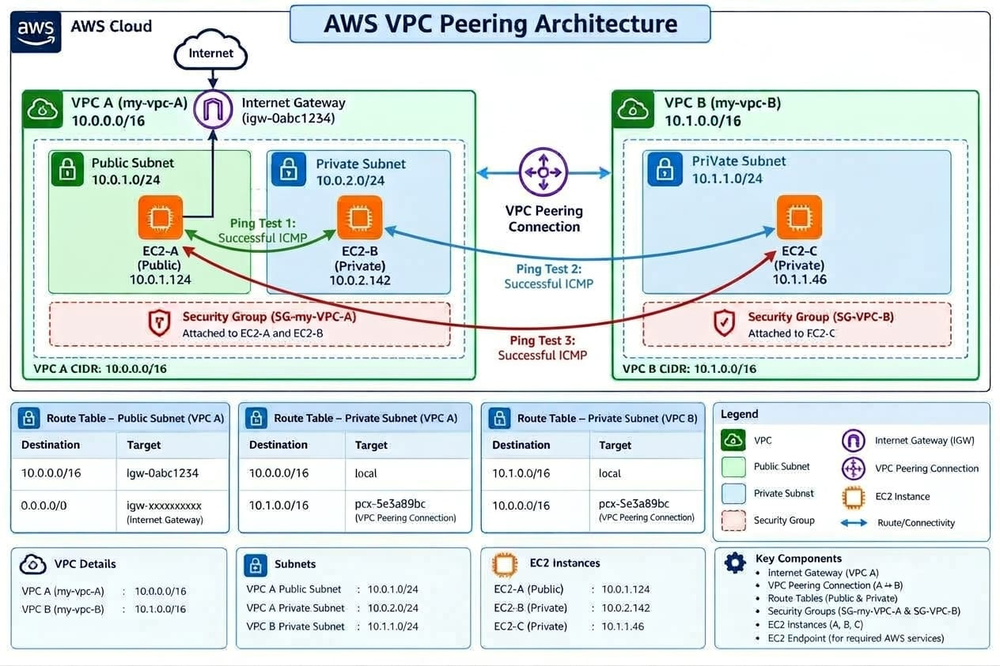

# AWS VPC Peering and EC2 Private Connectivity

## 📌 Project Overview

This project demonstrates how to create and configure two Amazon Virtual Private Clouds (VPCs) in AWS and establish private communication between EC2 instances using VPC Peering.

VPC A contains one public subnet and one private subnet, while VPC B contains one private subnet. Three EC2 instances are deployed across these subnets to test private IP connectivity.

The main goal is to understand VPC networking, subnet configuration, route tables, Internet Gateway, security groups, VPC Peering, and connectivity testing using `ping` and SSH.

## 🎯 Objectives

- Create two separate VPCs with non-overlapping CIDR blocks.
- Configure public and private subnets.
- Launch EC2 instances in the appropriate subnets.
- Configure an Internet Gateway for the public subnet.
- Establish a VPC Peering connection between the two VPCs.
- Configure route tables to enable private communication between VPCs.
- Configure security groups to allow the required network traffic.
- Test connectivity between EC2 instances using their private IP addresses.

## 🏗️ Architecture

The project consists of two VPCs connected through a VPC Peering connection.

### VPC A — `my-vpc-A`

**CIDR block:** `10.0.0.0/16`

| Component | Configuration |
|---|---|
| Public subnet | `10.0.1.0/24` |
| Private subnet | `10.0.2.0/24` |
| EC2-A | Public EC2 instance |
| EC2-B | Private EC2 instance |
| Internet Gateway | Attached to VPC A |
| Route tables | Public and private route tables |

### VPC B — `my-vpc-B`

**CIDR block:** `10.1.0.0/16`

| Component | Configuration |
|---|---|
| Private subnet | `10.1.1.0/24` |
| EC2-C | Private EC2 instance |
| Route table | Private route table |

### Network Diagram

Add your architecture image to the repository, for example, in an `images` folder.

```markdown

```

## 🛠️ AWS Services Used

- **Amazon VPC:** Creates isolated virtual networks.
- **Amazon EC2:** Provides virtual servers for connectivity testing.
- **Subnets:** Separate public and private resources within each VPC.
- **Internet Gateway:** Provides internet connectivity for appropriately configured resources in the public subnet.
- **Route Tables:** Define where network traffic is directed.
- **VPC Peering:** Enables private communication between the two VPCs.
- **Security Groups:** Control inbound and outbound traffic for EC2 instances.

## 🗺️ Routing Configuration

### Public Route Table — VPC A

| Destination | Target |
|---|---|
| `10.0.0.0/16` | Local |
| `0.0.0.0/0` | Internet Gateway |
| `10.1.0.0/16` | VPC Peering Connection |

### Private Route Table — VPC A

| Destination | Target |
|---|---|
| `10.0.0.0/16` | Local |
| `10.1.0.0/16` | VPC Peering Connection |

### Private Route Table — VPC B

| Destination | Target |
|---|---|
| `10.1.0.0/16` | Local |
| `10.0.0.0/16` | VPC Peering Connection |

These routes allow traffic to travel between the two VPCs through the peering connection.

## 🔐 Security Group Configuration

Security groups are configured to allow the network traffic required for the project.

### VPC A Security Group

- Allow SSH (TCP port 22) from the administrator's public IP address to access EC2-A.
- Allow SSH from the public subnet (`10.0.1.0/24`) where required for EC2-A to connect to EC2-B.
- Allow ICMP traffic from the VPC A CIDR (`10.0.0.0/16`).
- Allow ICMP traffic from the VPC B CIDR (`10.1.0.0/16`).

### VPC B Security Group

- Allow ICMP traffic from VPC A (`10.0.0.0/16`).
- Allow ICMP traffic from VPC B (`10.1.0.0/16`).

Default outbound rules allow the instances to initiate the required traffic.

**Security note:** SSH access should be restricted to trusted sources. Do not expose SSH to `0.0.0.0/0` unless there is a specific, temporary, justified requirement.

## 🔗 VPC Peering Configuration

A VPC Peering connection named `my-vpc-A-to-my-vpc-B` connects VPC A and VPC B.

The peering connection is configured by:

1. Creating a peering request between the two VPCs.
2. Accepting the peering request.
3. Adding the peer VPC CIDR route to the relevant route tables.
4. Configuring security groups to permit the required traffic.

VPC Peering enables private IP communication between the VPCs when routing and security rules permit it. It does not automatically provide internet access to private instances or allow transitive routing through another VPC.

## 🧪 Connectivity Testing

Connectivity is tested using the private IP addresses of the EC2 instances.

From EC2-A, test connectivity to EC2-B:

```bash
ping -c 4 <EC2-B-PRIVATE-IP>
```

From EC2-A, test connectivity to EC2-C:

```bash
ping -c 4 <EC2-C-PRIVATE-IP>
```

From EC2-B, test connectivity to EC2-C:

```bash
ping -c 4 <EC2-C-PRIVATE-IP>
```

Replace each placeholder with the instance's actual private IPv4 address.

A successful ping displays replies from the destination instance. If a test fails, check route tables, security group rules, network ACLs, instance state, and the destination IP address.

SSH connectivity is a separate test because SSH uses TCP port 22, whereas ping uses ICMP.

## 📚 Key Learnings

Through this project, I learned how to:

- Create and configure VPCs and subnets in AWS.
- Understand the difference between public and private subnets.
- Configure route tables and Internet Gateway routing.
- Establish VPC Peering between two VPCs.
- Configure security groups for network communication.
- Test private IP connectivity between EC2 instances.
- Troubleshoot networking and SSH connectivity issues.
- Understand how routing and security rules work together.

## 💰 Cost Management

This project uses EC2 instances and AWS networking resources for learning and testing.

To control costs:

- Terminate EC2 instances when testing is complete.
- Verify that attached EBS volumes are deleted when no longer needed.
- Avoid creating a NAT Gateway unless it is specifically required.
- Check for unused Elastic IP addresses and other billable resources.
- Monitor AWS Billing and Cost Management.

VPCs, subnets, route tables, and VPC Peering generally do not have hourly charges by themselves, but EC2 usage, storage, public IPv4 addresses, data transfer, and other services may incur charges.

## 🚀 Conclusion

This project demonstrates the configuration of a multi-VPC network in AWS using VPC Peering. It provides hands-on experience with subnet design, route tables, security groups, and private connectivity between EC2 instances.

The final connectivity results should be documented with screenshots from the AWS Console and terminal output after the required tests have been completed.

## 👤 Author

**Juhi Singh**

AWS Networking Project — VPC Peering and EC2 Private Connectivity
